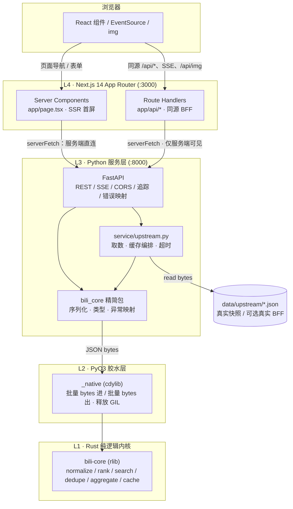

# Bili Hybrid 架构说明

> 后端用 **Rust** 实现核心业务逻辑与高性能模块，封装成**精简的 Python 包**供上层调用，前端用 **Next.js** 构建。
> 本文回答五个问题：**各层职责划分**、**Rust ↔ Python 接口设计**、**前后端通信方式**、**项目整体结构**、**构建流程**。

业务载体沿用一份真实的 B 站数据快照（2026-11-09，66 条视频，四套不同 schema），让 Rust 的归一化、打分、检索、聚合有真实负载，而不是空跑 benchmark。

---

## 1. 各层的职责划分

### 1.1 分层总览



依赖是**单向向下**的：Rust 内核不知道 Python 存在，Python 包不知道 FastAPI 存在，FastAPI 不知道 Next.js 存在，浏览器不知道 FastAPI 的地址。任何一层都可以单独替换或单独测试。

### 1.2 逐层职责与「刻意不放什么」

| 层 | 目录 | 职责 | 刻意不放什么 |
| --- | --- | --- | --- |
| **L1 Rust 内核** | `rust/` | 多 schema 归一化、清洗 `<em>` 标签、时长解析、去重、加权热度打分 + 时间半衰期、`rayon` 并行排序、BM25 检索、HTML 安全高亮、聚合统计、进程内 TTL + 近似 LRU 缓存 | 不做网络 / 磁盘 I/O；不依赖 Python、PyO3；不解析 HTTP；不认识 FastAPI |
| **L2 PyO3 胶水** | `rust-py/` | 只做 ABI 转换：把 `&[u8]` / `Vec<u8>` 暴露成 Python 可调用对象，`py.allow_threads` 释放 GIL，把 `CoreError` 转成 `PyValueError` | 不含任何业务分支；不写算法；不做序列化逻辑（只透传 bytes） |
| **L3a Python 精简包** | `python/bili_core/` | ① `list/dict ↔ JSON bytes` ② `TypedDict` 类型提示 + `py.typed` ③ 结构化异常 `BiliCoreError` 与 HTTP 状态映射 ④ 导出稳定 API | 不复制任何业务逻辑；不写 `for` 循环算分；不直接被 HTTP 层之外的业务代码绕过 |
| **L3b FastAPI 服务** | `python/service/` | I/O 编排（读快照 / 发 HTTP）、REST 与 SSE 协议、CORS、参数校验与限额、请求追踪、错误映射、缓存编排 | 不做归一化 / 打分 / 检索；不在 Python 里遍历视频做计算 |
| **L4 Next.js** | `web/` | SSR 首屏、交互 UI、同源 `/api/*` BFF、SSE 字节透传、图片代理与白名单、TypeScript 单一数据契约 | 不把 FastAPI 地址暴露给浏览器；不直接访问第三方图床；不重复实现后端业务 |

**分工判据**：CPU 密集 + 需要确定性 / 并行的部分下沉到 Rust；I/O 密集 + 协议编排留在 Python；渲染与浏览器侧安全边界留在 Next.js。

### 1.3 为什么 Rust 内核要拆成两个 crate

最初把 PyO3 和业务逻辑放在同一个 crate 里，结果 `cargo test` 链接测试二进制时失败：

```text
rust-lld: error: relocation R_X86_64_PC32 cannot be used against symbol 'stderr';
recompile with -fPIC
```

根因是 pyenv 的 Python 3.11 以 `Py_ENABLE_SHARED=0` 构建，只有**非 PIC 的静态** `libpython3.11.a`；而 Rust 测试二进制需要链接它。尝试 `RUSTFLAGS="-C link-arg=-no-pie"` 又会让 proc-macro 动态库报 `undefined symbol: main`，不可行。

最终按「可测试性」拆成：

- `rust/` → `bili-core`，`crate-type = ["rlib"]`，依赖只有 `serde` / `serde_json` / `rayon`，**完全不链接 libpython**，`cargo test -p bili-core` 7 个单测直接跑通；
- `rust-py/` → `bili-core-py`，`crate-type = ["cdylib"]`，只被 maturin 用来产 wheel（`cdylib` 不链接 libpython，符号由 Python 进程在导入时提供）。

这个拆分顺带带来一个好处：内核可以作为普通 Rust 依赖被未来的 CLI、gRPC 服务或 WASM 模块复用。

---

## 2. Rust ↔ Python 接口设计

### 2.1 绑定技术与产物

| 项 | 值 |
| --- | --- |
| 绑定库 | PyO3 0.23（`extension-module` + `macros`） |
| 构建工具 | maturin 1.16，`bindings = "pyo3"` |
| 扩展模块名 | `bili_core._native`（`module-name` 指定，产物 `_native.cpython-311-x86_64-linux-gnu.so`） |
| wheel | `dist/bili_core-0.1.0-cp311-cp311-manylinux_2_34_x86_64.whl`（约 378 KB） |
| Python 支持 | `>=3.10`；wheel 按 CPython ABI 打标签，换 Python 版本需重新构建 |

`pyproject.toml` 里 `manifest-path` 指向 `rust-py/Cargo.toml`、`python-source = "python"`，因此 wheel 里同时包含手写的 Python 薄包和编译产物。

### 2.2 三条接口原则

**① 批量语义（batch, not per-item）**
N 条视频只发生 **1 次** Python→Rust→Python 跨界，而不是 N 次。这是混合架构里最关键的性能决策：PyO3 调用本身的开销远大于单条数据的计算，逐条调用会让 Rust 的并行优势被跨界开销吃光。

**② 字节契约（`&[u8]` → `Vec<u8>`，载荷为 JSON bytes）**
不逐字段构造 `PyDict` / `PyList`，避免 N×M 次 Python 对象分配与引用计数操作。Rust 侧用 `serde_json` 直接反序列化成 `Vec<Video>`，Python 侧 `json.dumps/loads` 一次。代价是多一次序列化拷贝，但在批量语义下这笔开销固定且很小。

**③ 释放 GIL（`py.allow_threads`）**
所有计算函数都包在 `detach()` 里：

```rust
fn detach<T, F>(py: Python<'_>, f: F) -> PyResult<T>
where
    F: FnOnce() -> error::CoreResult<T> + Send,
    T: Send,
{
    py.allow_threads(f).map_err(py_err)
}
```

闭包内只持有 Rust 所有权数据（`String` / `Vec<u8>`），因此 `rayon` 的 `par_iter()` 是真并行，且 FastAPI 的其他线程在 Rust 打分期间仍可处理请求。

### 2.3 函数签名对照表

| Rust `#[pyfunction]`（`rust-py/src/lib.rs`） | Python `bili_core`（`__init__.py`） | 输入 | 输出 |
| --- | --- | --- | --- |
| `normalize_batch(source: &str, raw: &[u8]) -> Vec<u8>` | `normalize_batch(source, payload) -> list[Video]` | 上游原始 JSON bytes | 归一化 `Video[]` |
| `rank_videos(videos, weights, limit: usize)` | `rank(videos, weights=None, limit=0)` | `Video[]` + 权重 bytes | 带 `score` 的降序 `Video[]` |
| `search_videos(videos, query: &str, limit)` | `search(videos, query, limit=0)` | `Video[]` + 查询串 | 带 `score` / `highlight` 的 `Video[]` |
| `dedupe_videos(videos)` | `dedupe(videos)` | `Video[]` | 按 `bvid` 去重 |
| `aggregate_videos(videos)` | `aggregate(videos)` | `Video[]` | `Aggregate` 对象 |
| `cache_get / cache_put / cache_stats / cache_clear` | `cache_*`，另有 `cache_get_json` / `cache_set_json` | key / value bytes | bytes / 统计对象 |
| `core_info() -> String` | `core_info() -> dict` | — | 内核版本与能力清单 |

调用方只 `import bili_core`，**永远不直接 import `_native`**；后者是实现细节。

### 2.4 单一数据契约（三语言同构）

同一个 `Video` 结构在三层各写一次声明，字段完全一致（camelCase）：

| 层 | 声明位置 | 机制 |
| --- | --- | --- |
| Rust | `rust/src/model.rs` | `#[derive(Serialize, Deserialize)]` + `#[serde(rename_all = "camelCase")]` |
| Python | `python/bili_core/models.py` | `TypedDict` + `py.typed`（mypy / pyright 可检查） |
| TypeScript | `web/lib/types.ts` | `interface`，含 `VideoListResponse` / `Aggregate` / `HealthInfo` / `ApiError` |

新增字段时三处同步；`score` 与 `highlight` 为可选字段，Rust 用 `#[serde(skip_serializing_if = "Option::is_none")]` 避免输出 `null`。`highlight` 在 Rust 侧已做过 `html_escape()` 再包 `<mark>`，前端可以安全内联渲染——**XSS 防线放在生成侧，而不是渲染侧**。

### 2.5 单一错误通道

跨语言错误不靠字符串猜测，而是结构化编码：

```text
Rust  CoreError::{InvalidJson, InvalidInput, State}
  ↓  code() + payload() → {"code":"INVALID_JSON","message":"..."}
PyO3  PyValueError(结构化 JSON 字符串)
  ↓  _call() 捕获 ValueError
Python BiliCoreError(code, message) · http_status: 400 / 422 / 503 / 500
  ↓  @app.exception_handler(BiliCoreError)
HTTP  {"error":{"code":"...","message":"..."},"requestId":"..."}
```

| `CoreError` | code | HTTP |
| --- | --- | --- |
| `InvalidJson` | `INVALID_JSON` | 400 |
| `InvalidInput` | `INVALID_INPUT` | 422 |
| `State` | `STATE_ERROR` | 503 |
| 未识别 | `UNKNOWN` | 500 |

### 2.6 Rust 内核能力细节

| 模块 | 实现要点 |
| --- | --- |
| `normalize.rs` | 兼容数组 payload、`{data:{list:[...]}}` 嵌套、搜索扁平 schema；`pick()` 多字段名兜底（`owner` / `author` / `mid`）；清洗 `<em class="keyword">` 标签；`mm:ss` → 秒并反向格式化；封面协议补全；`dedupe()` 按 `bvid` |
| `rank.rs` | `Weights { view, danmaku, reply, like, coin, favorite, share, halfLifeHours, now }`，互动数取 `ln_1p()` 抑制头部效应，乘 `2^(-Δt / halfLifeHours)` 时间衰减；`rayon::par_iter` 打分后稳定排序 |
| `search.rs` | BM25；`tokenize()` 中文单字 + bigram、ASCII 按词；标题精确包含额外加权；`html_escape()` 后生成 `<mark>` 高亮 |
| `cache.rs` | `OnceLock<Mutex<Store>>` 全局单例，TTL + 近似 LRU，容量 256；`get` / `put` / `stats` / `clear`；命中统计暴露到 `/health` |
| `error.rs` | 纯 Rust 错误类型，`payload()` 生成结构化 JSON |
| `model.rs` | 强类型 `Owner` / `Stat` / `Video` |

### 2.7 边界的代价与适用条件

JSON bytes 契约在**批量、中等数据量**下最优；如果未来出现超大数据集或逐条流式处理，应考虑换成 Apache Arrow / `pyo3-arrow` 或把整个流水线留在 Rust 内（Python 只发指令）。当前 66～数千条视频规模下，一次调用 1～10 ms，跨界开销可忽略。

---

## 3. 前后端通信方式

### 3.1 三条通路并存

| 通路 | 链路 | 用途 | 关键实现 |
| --- | --- | --- | --- |
| **SSR 首屏** | 浏览器 → Next.js Server Component → `serverFetch()` → FastAPI | 首屏 HTML、Tabs、搜索结果页 | `app/page.tsx` `export const dynamic = "force-dynamic"`，服务端到服务端少一跳 |
| **同源 BFF** | 浏览器 → `/api/*` Route Handler → `serverFetch()` → FastAPI | 交互请求、健康检查、参数校验 | `web/app/api/{health,videos,rank,search}/route.ts` |
| **SSE 流式** | 浏览器 `EventSource` → `/api/stream/rank` → FastAPI `/v1/stream/rank` | 长任务进度、实时榜单 | Route Handler **不解析、不缓冲**，直接回传 `upstream.body` |

另外 `/api/img` 是旁路：同源图片代理，校验 `https:` 协议与 `/(^|\.)hdslb\.com$/` 白名单，注入 `Referer: https://www.bilibili.com/` 绕过防盗链，响应带 `Cache-Control: public, max-age=86400, immutable`。

### 3.2 地址与可见性

```ts
// web/lib/api.ts
export const PYTHON_API_ORIGIN =
  process.env.PYTHON_API_ORIGIN ?? "http://127.0.0.1:8000";
```

**刻意不加 `NEXT_PUBLIC_` 前缀**：该变量只在 Node 服务端求值，永不被打进浏览器 bundle。浏览器只认识同源 `/api/*`，因此：

- 后端地址、端口、内部拓扑不下发到客户端；
- CORS 只需允许开发/预览域名（`CORS_ORIGINS`），生产同源请求根本不触发 CORS；
- 浏览器侧天然同源，不受混合内容与第三方 Cookie 策略影响。

### 3.3 端点对照表

| 浏览器 / SSR | FastAPI | 说明 |
| --- | --- | --- |
| `/?tab=feed` (SSR) | `GET /v1/videos?source=feed&limit=16` | 推荐流 |
| `/?tab=rank` (SSR) | `GET /v1/rank?limit=16` | Rust 并行热度榜 |
| `/?tab=search&q=…` (SSR) | `GET /v1/search?q=…&limit=16` | BM25 检索 |
| (SSR 附带) | `GET /v1/stats`、`GET /health` | 统计条与内核健康 |
| `GET /api/health` | `GET /health` | 失败降级 502 |
| `GET /api/videos?source=&limit=` | `GET /v1/videos` | `source` 白名单、`limit ≤ 200` |
| `GET /api/rank?limit=&halfLifeHours=` | `GET /v1/rank` | `limit ≤ 100`、半衰期夹取 |
| `GET /api/search?q=&limit=` | `GET /v1/search` | 空 `q` 返回 422 |
| `GET /api/stream/rank` | `GET /v1/stream/rank` | `text/event-stream` 字节透传 |
| `GET /api/img?url=` | 直连 `*.hdslb.com` | 白名单 + Referer |
| — | `POST /v1/cache/clear` | 运维端点，仅服务端调用 |

### 3.4 协议细节

**SSE 事件序列**（FastAPI 生成器逐条 yield，Route Handler 原样透传）：

```text
event: source   data: {"source":"feed","count":66,"elapsedMs":2.0}
event: source   data: {"source":"rank","count":66,"elapsedMs":3.9}
event: source   data: {"source":"popular","count":66,"elapsedMs":5.9}
event: source   data: {"source":"search","count":66,"elapsedMs":7.7}
event: result   data: {"total":264,"top":[{"title":"…","score":12.24,"bvid":"BV…"}, …]}
event: done     data: {}
```

前端 `components/LiveRank.tsx` 用 `EventSource` 分别监听 `source` / `result` / `done` / `error`。响应头带 `Cache-Control: no-cache, no-transform` 与 `X-Accel-Buffering: no`，避免反向代理缓冲。

**链路追踪**：`serverFetch()` 生成 12 位 `X-Request-Id` 注入上游；FastAPI `trace` middleware 回写 `X-Request-Id`、`X-Engine: rust-pyo3`、`Server-Timing: api;dur=…ms`。前端可据此定位"慢在 Python 编排还是 Rust 计算"。

**超时与降级**：

| 位置 | 超时 | 失败行为 |
| --- | --- | --- |
| `serverFetch()` | 8 s（`AbortSignal.timeout`） | 抛错 → BFF 返回 `{error:{code:"UPSTREAM_ERROR"}}` + 502 |
| SSE Route Handler | 15 s 建连 | 502 文本响应 |
| `/api/img` | 8 s | 502 空响应（不拖垮页面） |
| SSR 统计 / 健康 | 共用 8 s | 单独 try/catch，失败不阻塞主体内容 |

**上游可切换**：`service/upstream.py` 默认读 `data/upstream/*.json` 离线快照；设置 `UPSTREAM_BFF_URL` 后改为请求真实 BFF 的 `/api/feed`、`/api/rank` 等端点，**其余各层零改动**——这正是把 I/O 留在 Python 的价值。

---

## 4. 项目整体结构

```text
bili-hybrid/
├── Cargo.toml                     Rust workspace：members = ["rust", "rust-py"]，release LTO/panic=abort
├── Cargo.lock
├── pyproject.toml                 maturin 打包配置（wheel 名、module-name、python-source）
│
├── rust/                          【L1】纯 Rust 内核 bili-core（rlib，无 Python 依赖）
│   ├── Cargo.toml
│   └── src/
│       ├── lib.rs                 模块导出，明确声明「不知道 Python 的存在」
│       ├── model.rs               Owner / Stat / Video，camelCase 契约
│       ├── error.rs               CoreError + payload()
│       ├── normalize.rs           多 schema 归一化、清洗、时长解析、dedupe
│       ├── rank.rs                权重打分、时间半衰期、rayon 并行排序、aggregate
│       ├── search.rs              BM25、分词、HTML 转义与 <mark> 高亮
│       └── cache.rs               OnceLock<Mutex<Store>> TTL + LRU
│
├── rust-py/                       【L2】PyO3 胶水 bili-core-py（cdylib → _native）
│   ├── Cargo.toml
│   └── src/lib.rs                 10 个 #[pyfunction]、detach() 释放 GIL、py_err()
│
├── python/
│   ├── bili_core/                 【L3a】精简 Python 包
│   │   ├── __init__.py            序列化 / 反序列化、_call() 异常映射、稳定 API
│   │   ├── models.py              TypedDict 契约
│   │   ├── errors.py              BiliCoreError + HTTP 状态表
│   │   ├── py.typed               PEP 561 标记
│   │   └── _native*.so            wheel 产物（本地开发时从 wheel 解出）
│   └── service/                   【L3b】FastAPI I/O 编排层
│       ├── main.py                REST / SSE / CORS / trace / 错误映射
│       └── upstream.py            取数、缓存编排、目录自动探测
│
├── data/upstream/                 真实快照（4 套 schema × 66 条视频）
│   ├── feed.json / popular.json   数组
│   └── rank.json / search.json    嵌套对象 / 扁平字段，含 <em> 标签与 mm:ss 时长
├── scripts/
│   ├── gen_fixtures.py            从 bili-lite 快照生成上述 4 套 fixture
│   └── build.sh                   一键构建脚本
│
├── web/                           【L4】Next.js 14 App Router
│   ├── app/page.tsx               SSR 首页（Tabs / 搜索 / 统计 / 视频网格）
│   ├── app/layout.tsx             根布局
│   ├── app/globals.css            响应式玻璃视觉（4→3→2→1 列）
│   ├── app/api/health/route.ts
│   ├── app/api/videos/route.ts
│   ├── app/api/rank/route.ts
│   ├── app/api/search/route.ts
│   ├── app/api/stream/rank/route.ts   SSE 字节透传
│   ├── app/api/img/route.ts            图片代理白名单
│   ├── components/VideoCard.tsx        Server Component
│   ├── components/LiveRank.tsx         Client Component（EventSource）
│   ├── lib/api.ts                     serverFetch / imgProxy / compact / relative
│   ├── lib/types.ts                   TypeScript 单一契约
│   ├── next.config.mjs / tsconfig.json / package.json
│
├── dist/*.whl                     maturin 产物
├── Makefile                       构建 / 测试 / 运行 / 验证目标
├── Dockerfile                     三阶段：wheel → api → web
├── docker-compose.yml             api(8000) + web(3000)
├── ARCHITECTURE.md                本文
└── README.md                      快速开始
```

---

## 5. 构建流程

### 5.1 前置工具链

| 工具 | 实测版本 | 用途 |
| --- | --- | --- |
| Rust / Cargo | 1.93.0 | 编译内核与 PyO3 扩展 |
| Python | 3.11.1 | wheel ABI、FastAPI 运行时 |
| maturin | 1.16.0 | 把 cdylib 打成 wheel |
| Node / npm | 22.13.1 / 11.9.0 | Next.js |
| FastAPI / uvicorn | 已安装 | HTTP 服务 |
| Playwright + Chromium | 已安装 | 端到端验收 |

### 5.2 一键脚本与 Makefile

```bash
make all          # = test-rust → wheel → install → typecheck → build-web
make dev          # 并行启动 API(:8000) 与 Web(:3000)
make verify       # curl 冒烟 + Playwright 端到端
```

推荐手工顺序（与 `scripts/build.sh` 一致）：

```bash
# 1) 纯 Rust 内核单测（不链接 libpython）
cargo test -p bili-core                      # 7 passed

# 2) 编译 PyO3 扩展并打 wheel
maturin build --release --out dist          # dist/bili_core-0.1.0-...whl

# 3) 安装到 Python 环境
pip3 install --force-reinstall dist/*.whl

# 4) 前端类型检查与生产构建
cd web
npm ci
npm run typecheck                           # tsc --noEmit，0 error
npm run build                               # next build

# 5) 启动（两个终端 / 两个后台进程）
cd .. && PYTHONPATH=python \
  uvicorn service.main:app --app-dir python --host 0.0.0.0 --port 8000
cd web && PYTHON_API_ORIGIN=http://127.0.0.1:8000 npm run start
```

开发模式可用 `maturin develop`（把 `.so` 直接放进源码包）跳过 wheel 安装；前端用 `npm run dev` 获得 HMR。生产模式走 wheel + `next build` + `next start`。

### 5.3 Docker 多阶段构建

`Dockerfile` 三个最终目标：

| Stage | 基础镜像 | 产出 |
| --- | --- | --- |
| `wheel` | `python:3.11-slim-bookworm` + rustup + maturin | `maturin build --release --out /wheels` |
| `api` | `python:3.11-slim-bookworm` | 安装 wheel + fastapi/uvicorn，`CMD uvicorn …:8000` |
| `webbuild` / `web` | `node:22-alpine` | `npm ci && npm run build` → 只拷贝 `.next` 与 `node_modules`，`CMD next start` |

`docker-compose.yml` 定义 `api` 与 `web` 两个服务，`web.environment.PYTHON_API_ORIGIN = http://api:8000`（容器间走服务名），`depends_on: [api]`；只把 `3000`/`8000` 按需映射到宿主机。`python/service/upstream.py` 的 `_default_data_dir()` 会自动识别源码树与容器两种布局，也可用 `DATA_DIR` 显式覆盖。

> **本环境验证边界**：`docker compose config -q` 已通过（`api` / `web` 两个服务解析正常），但**未执行完整镜像构建**。容器构建需要拉取额外基础镜像层并在镜像内下载 rustup 工具链，而当前沙箱到 Docker Registry / `static.rust-lang.org` 的连接不稳定（`registry-1.docker.io` 心跳超时）。本地（非容器）构建流程已完整实测，见第 6 节；在可访问外网的环境执行 `docker compose up --build` 即可。

### 5.4 环境变量

| 变量 | 层 | 默认 | 说明 |
| --- | --- | --- | --- |
| `PYTHON_API_ORIGIN` | Next.js（**仅服务端**） | `http://127.0.0.1:8000` | FastAPI 地址；无 `NEXT_PUBLIC_` 前缀 |
| `CORS_ORIGINS` | FastAPI | `http://localhost:3000,http://127.0.0.1:3000` | 允许的开发域名 |
| `DATA_DIR` | Python I/O 层 | 自动探测 | 上游快照目录 |
| `UPSTREAM_BFF_URL` | Python I/O 层 | 空 | 非空则改为请求真实 BFF |
| `UPSTREAM_TIMEOUT` | Python I/O 层 | `8` | 上游超时（秒） |
| `CACHE_TTL` | Python I/O 层 | `60` | Rust 侧归一化结果缓存（秒） |

### 5.5 构建顺序的依赖关系

```text
rust/ (rlib)  ──┐
                ├──> rust-py/ (cdylib) ──> wheel ──> site-packages
rust-py/      ──┘                                        │
                                                        ├──> FastAPI 启动
web/ (TS) ──> typecheck ──> next build ──> next start ───┘（运行时调用）
```

Rust 内核与前端**可以并行构建**，二者只在运行时通过 FastAPI 汇合；wheel 是 Python 服务启动的硬前置。

---

## 6. 验证结果

### 6.1 构建与静态检查

| 项 | 结果 |
| --- | --- |
| `cargo test -p bili-core` | **7 passed / 0 failed**（normalize ×3、rank ×2、search ×2） |
| `maturin build --release` | 成功，生成 `bili_core-0.1.0-cp311-cp311-manylinux_2_34_x86_64.whl` |
| `npx tsc --noEmit` | 0 error |
| `npm run build` | 成功；`/` 为 ƒ Dynamic，7 个 `/api/*` 路由全部注册，First Load JS ≈ 88 kB |

### 6.2 Rust ↔ Python 包级联调

| 能力 | 结果 |
| --- | --- |
| `normalize_batch` | 4 套 schema → 66 条 `Video` |
| `rank` | rayon 打分排序，Top1 score ≈ 12.24 |
| `search` | BM25 + `<mark>` 安全高亮 |
| `aggregate` | `count=66`、`totalView=111344686`、`totalLike=8612090`、`avgDuration=5639` |
| `cache_*` | set/get/stats/clear 正常 |
| `BiliCoreError` | `INVALID_JSON` → `http_status = 400` |

### 6.3 HTTP 实测

| 端点 | 结果 |
| --- | --- |
| `GET /health` | 200；`engine=rust`、`bindings=pyo3`、`kernel=bili-core`、`parallel=true`；cache capacity 256；upstream `mode=snapshot`、4 sources |
| `GET /v1/videos?source=feed&limit=3` | 200；`total=66`，`durationText`、`owner.name` 正确 |
| `GET /v1/rank?limit=5&halfLifeHours=72` | 200；`engine=rust/rayon`，Top1 `12.24` |
| `GET /v1/search?q=总决赛` | 200；`【2026全球<mark>总决赛</mark>】11月9日 BLG vs T1` |
| `GET /v1/stats` | 200；聚合数值与包级一致 |
| `GET /v1/stream/rank` | `text/event-stream`；4×`source` + `result` + `done` |
| `POST /v1/cache/clear` | 200；`{"ok":true}`，命中计数正常 |
| 非法 `source=unknown` | 422，FastAPI 参数校验错误体 |
| 响应头 | `X-Request-Id`、`X-Engine: rust-pyo3`、`Server-Timing: api;dur=…` 全部存在 |

> `q=Rust` 返回 `total=0` 属预期：快照取自真实 B 站内容，无 Rust 相关视频；换用「总决赛 / 短剧 / 星穹铁道 / 原神 / AI」均正确命中并高亮。

### 6.4 浏览器端到端验收

`scripts/verify_e2e.py`（Playwright + Chromium）共 **18 项断言，18/18 通过**：

| 类别 | 断言 | 结果 |
| --- | --- | --- |
| 同源 BFF | `/api/health` 返回 `kernel=bili-core` | 200 |
| 同源 BFF | `/api/videos` `total=66`、`limit=3` 生效 | 200 |
| 同源 BFF | `/api/rank` `engine=rust/rayon`、Top1 `12.22` | 200 |
| 同源 BFF | `/api/search?q=总决赛` 含 `<mark>` | 200 |
| 参数校验 | 空 `q` / 非法 `source` 均返回 422 | 422 |
| 图片代理 | 白名单放行 `image/jpeg` 319 KB；`evil.example.com` 拒绝 | 200 / 403 |
| SSE | `source×4 + result + done`，`Content-Type: text/event-stream` | 200 |
| SSR | 首页 200，16 张卡片；健康条显示 `rust 0.1.0 · pyo3 · bili-core` | 通过 |
| SSE 客户端 | `LiveRank` 状态 `done`，4 行进度 + Top5 | 通过 |
| 图片 | 16/16 张封面 `naturalWidth > 0` | 通过 |
| 交互 | Tab 热度榜标题与 16 个 score 徽标 | 通过 |
| 交互 | 搜索表单提交后 1 处 `<mark>` 高亮 | 通过 |
| 响应式 | 390px 下 `grid-template-columns` 为单列 | 通过 |
| 响应式 | 390px 无横向溢出，调用链 chips 保持单行（窄屏 CSS 修复后复测） | 通过 |
| 稳定性 | `console error = 0`、`pageerror = 0` | 通过 |

截图归档于 `docs/preview/`：

| 文件 | 内容 |
| --- | --- |
| `01-home.png` | 1440px SSR 首页（推荐流 + SSE 流水线完成态） |
| `02-rank.png` | Rust 并行热度榜（score / 名次徽标） |
| `03-search.png` | 「总决赛」BM25 结果与 `<mark>` 高亮 |
| `04-mobile.png` | 390px 全页单列布局 |
| `05-mobile-top.png` | 390px 首屏视口 |

---

## 7. 设计取舍与扩展点

| 取舍 | 理由 | 何时该改 |
| --- | --- | --- |
| JSON bytes 而非逐字段 PyDict | 批量下跨界次数 O(1)，实现简单 | 数据量到百万级 → Arrow / 零拷贝 buffer |
| 归一化逻辑放 Rust | 4 套 schema 的分支判断是 CPU 密集且需要确定性 | 若上游 schema 极不稳定，可把字段映射表外置为配置 |
| 缓存放 Rust 而非 Redis | 进程内、GIL 外命中，零网络开销 | 多副本部署 → 换 Redis，接口保持不变 |
| SSR 直连 + 同源 BFF 并存 | 首屏少一跳；交互请求统一安全边界 | 若需边缘渲染，可把 BFF 换成 Edge Runtime + 后端签名 |
| 不暴露 `NEXT_PUBLIC_` 后端地址 | 拓扑不下发、生产零 CORS | 无 |
| 真实快照而非实时接口 | 可离线复现、验收稳定 | 设 `UPSTREAM_BFF_URL` 即接真实上游 |

**扩展路径**：新增一个 Rust 能力时，只需在 `rust/` 实现 + 单测 → 在 `rust-py/src/lib.rs` 加一个 `#[pyfunction]`（沿用 `detach`）→ 在 `bili_core/__init__.py` 加一行薄封装 → 在 `service/main.py` 暴露端点 → 在 `web/app/api/` 加 Route Handler。四层改动各自独立、可分别验证。
